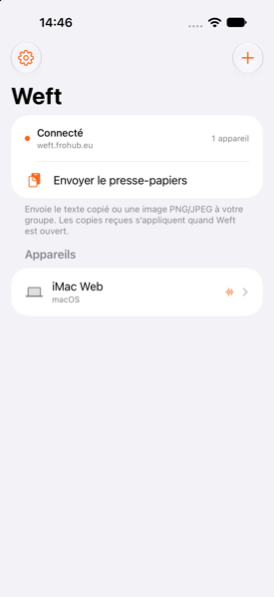
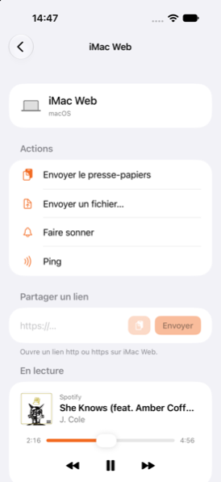
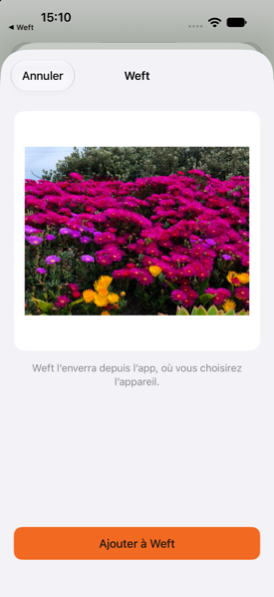
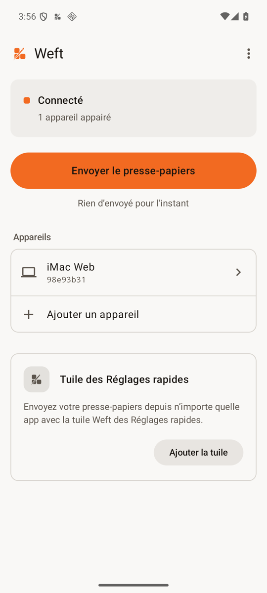
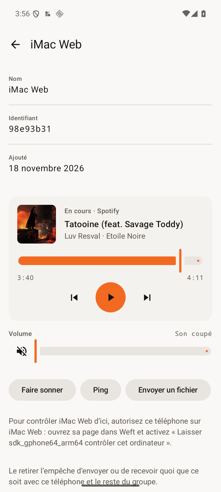
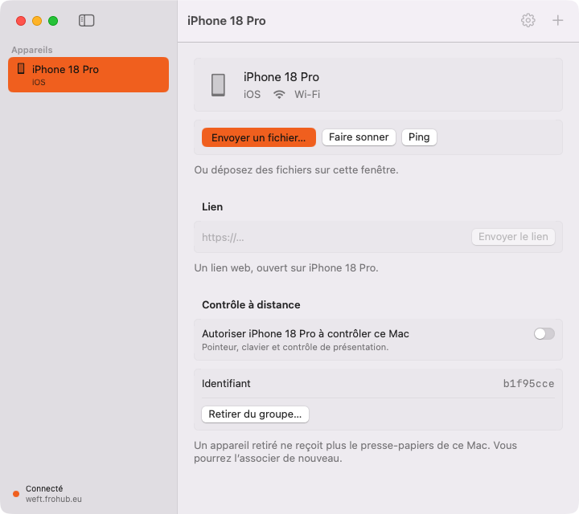

<p align="center">
  
</p>

# Weft

[English](README.md) · **Français**

**Votre presse-papiers, vos fichiers et vos notifications, tissés entre vos appareils, même sur les réseaux qui les séparent.**

Weft est une passerelle open source dans l'esprit de KDE Connect entre **Android**, **iOS**, **macOS**, **Windows** et **Linux**, avec un client en ligne de commande et un relais que chacun peut héberger. Les appareils se joignent toujours par un relais WebSocket sur Internet, chiffré de bout en bout : ils restent connectés sur le Wi-Fi d'un bureau, d'une école ou d'un hôtel, là où l'isolation des clients bloque le trafic direct. Quand ils partagent un réseau local, ils ouvrent en plus une route LAN directe et authentifiée, et repassent par le relais si elle tombe.

Spécifications du protocole : [`docs/protocol.md`](docs/protocol.md) et [`docs/features.md`](docs/features.md). Notes de conception initiales : [`docs/PLAN.md`](docs/PLAN.md).

## Captures d'écran

| iPhone | | |
| :---: | :---: | :---: |
|  |  |  |
| Accueil | Un Mac associé, avec sa lecture en cours | Extension de partage |

| Android | | macOS |
| :---: | :---: | :---: |
|  |  |  |
| Accueil | Un Mac associé, avec sa lecture en cours | Fenêtre principale |

## Fonctions

| Domaine | Détails |
| --- | --- |
| Presse-papiers | Automatique depuis macOS, Windows et Linux ; en un geste depuis Android (tuile des Réglages rapides, action de notification, feuille de partage ou bouton de l'app) et iOS (Envoyer le presse-papiers). Les contenus sensibles et ceux des gestionnaires de mots de passe (`EXTRA_IS_SENSITIVE`, `ConcealedType` / `TransientType` / `AutoGeneratedType`, `x-kde-passwordManagerHint`, formats d'exclusion du nuage et de l'historique Windows) sont ignorés. |
| Images du presse-papiers | Images PNG et JPEG jusqu'à 16 Mio, proposées puis acceptées à chaque transfert, vérifiées par une empreinte BLAKE2b et accusées morceau par morceau. Automatique depuis macOS, Windows et Linux ; explicite sur Android (Copier l'image sur mes appareils) et iOS. Une protection anti-écho empêche de renvoyer une image reçue. |
| Fichiers et liens | Morceaux de 128 Kio chiffrés de bout en bout avec contrôle de flux, reprise automatique pendant 24 heures, noms de fichiers assainis et placés dans Téléchargements seulement une fois complets, partage de liens HTTP/HTTPS. |
| Notifications et appels | Notifications Android reproduites sur macOS et Windows avec actions, réponse directe et suppression à distance (les codes à usage unique d'Android 15 et plus restent masqués). Alertes d'appels entrants et manqués, avec coupure de la sonnerie à distance. |
| Musique et volume | État de lecture dans les deux sens, commandes de lecture, position et pochette (`media.art`), notification de lecteur `MediaStyle` sur Android pour les ordinateurs associés, réglage du volume système et multimédia dans les deux sens. |
| État, sonnerie et ping | Niveau de batterie, type et force du réseau du téléphone, sonnerie forte dans les deux sens (« Localiser mon appareil ») avec arrêt à distance, et notifications de ping. |
| SMS et contacts | Sur activation (désactivé par défaut) : parcourir les conversations, envoyer des SMS et retrouver les contacts du téléphone depuis les ordinateurs associés. Gardés en mémoire seulement sur les ordinateurs, jamais écrits sur le disque. |
| Commande à distance et raccourcis | Pavé tactile, clavier et pointeur de présentation au gyroscope du téléphone vers l'ordinateur (autorisé explicitement pour chaque appareil sur l'ordinateur, désactivé par défaut), saisie depuis un ordinateur dans le téléphone via le clavier Weft facultatif, et raccourcis de l'ordinateur lancés depuis le téléphone. |
| Groupes d'appareils | Jusqu'à 10 appareils par groupe entre Android, iOS, macOS, Windows, Linux et le CLI. Association par QR code (`WEFT1:`), invitations de groupe (`0xB4`/`0xB5`) pour ajouter un nouvel ordinateur à un groupe existant, et mise en attente sur le relais des enveloppes chiffrées de groupe et de nom d'appareil (`0x03`–`0x06`) pour les appareils hors ligne. |

Sur Android, une app en arrière-plan ne peut plus lire le presse-papiers depuis Android 10. Comme KDE Connect, Weft le lit depuis une courte activité au premier plan, ouverte par la tuile des Réglages rapides, une action de notification, une cible de partage ou un bouton de l'app, sans root ni astuce ADB.

Sur iOS, l'app synchronise tant qu'elle est ouverte. iOS suspend les connexions en arrière-plan et demande l'accord avant qu'une app lise le presse-papiers : touchez **Envoyer le presse-papiers**, ou réglez Réglages › Apps › Weft › Coller depuis d'autres apps sur **Autoriser** pour ne plus voir la question. L'extension de partage met en file les photos, fichiers, liens et textes que Weft enverra.

## Fonctionnement

```
Android (Kotlin) ─┐                                ┌─ macOS (Swift + cœur Rust)
iOS (Swift) ──────┼── WSS 443 ── relais ── WSS 443 ┼─ Windows (Rust)
                  │       (weft.frohub.eu)         ├─ Linux (Rust)
                  │                                └─ CLI (Rust)
                  └──── route LAN authentifiée, quand ils partagent un réseau ────┘
```

- **Apps natives et cœur partagé :**
  - Android : Kotlin + Jetpack Compose, Material 3, avec `lazysodium-android` pour la cryptographie du protocole.
  - iOS : app Swift + SwiftUI (iOS 17 et plus) avec une extension de partage, construite sur le paquet Swift `WeftMobileKit`.
  - macOS : app Swift + SwiftUI dans la barre des menus, avec le cœur client Rust partagé via UniFFI, [Sparkle](https://sparkle-project.org) pour les mises à jour et [mediaremote-adapter](https://github.com/ungive/mediaremote-adapter) (BSD-3-Clause) pour la lecture en cours.
  - Windows : Rust + travailleur Win32 pour la zone de notification et le presse-papiers, interface WinUI 3 via [windows-reactor](https://github.com/microsoft/windows-rs/tree/master/crates/libs/reactor), avec `crates/weft-client` partagé avec macOS.
  - Linux (**expérimental**) : `weft-desktop`, un démon de service utilisateur et un CLI pour Wayland et X11, qui s'appuie sur les outils du bureau (presse-papiers, notifications, MPRIS2, PipeWire/PulseAudio, saisie). Il n'a pas encore d'interface graphique, et ses tests remplacent ces outils par des imitations : il n'a pas encore été validé sur un vrai bureau Linux. Voir [`linux/README.md`](linux/README.md).
  - CLI : binaire Rust `weft` pour associer, diffuser le presse-papiers et écrire des scripts depuis un terminal.
- **Relais :** écrit en Rust (`axum` + SQLite), publié en image Docker multi-architecture sur `ghcr.io/fraustiz/weft/relay`. Une instance publique tourne sur `weft.frohub.eu`, et chacun peut héberger la sienne (voir [`relay/README.md`](relay/README.md)) ; l'adresse du relais se règle dans les apps.
- **Sans compte :** chaque installation crée ses propres paires de clés Ed25519 et X25519, et les appareils s'associent directement par QR code.
- **Routes LAN :** les appareils associés annoncent leurs adresses IPv4 privées par le relais, s'authentifient mutuellement par un défi signé (`weft-lan-v2`) et échangent en direct les mêmes enveloppes scellées. Chaque trame est confirmée par un accusé ; une trame non confirmée repart par le relais avec les mêmes octets, et la protection anti-rejeu écarte tout doublon.

## Organisation du dépôt

- [`android/`](android/) : app Android (`:app`) et implémentation Kotlin du protocole (`:protocol`).
- [`ios/`](ios/) : app iOS SwiftUI, extension de partage et paquet `WeftMobileKit` (projet XcodeGen).
- [`macos/`](macos/) : app macOS SwiftUI, scripts d'empaquetage et configuration de Sparkle.
- [`windows/`](windows/) : app Windows en Rust (hôte Win32 pour la zone de notification et le presse-papiers, vues WinUI 3).
- [`linux/`](linux/) : démon et CLI Linux `weft-desktop` (expérimental).
- [`relay/`](relay/) : serveur relais WebSocket, Dockerfile et configuration Compose.
- [`cli/`](cli/) : client en ligne de commande `weft`.
- [`crates/`](crates/) : crates de l'espace de travail Rust : `weft-protocol` (protocole v1 et vecteurs de test de référence), `weft-client` (machine à états du client, transferts et paquets de fonctions) et `weft-ffi` (liaisons UniFFI pour macOS).
- [`swift/`](swift/) : paquet Swift autonome `WeftProtocol`, vérifié octet par octet avec `crates/weft-protocol/vectors/v1.json`.

## Modèle de sécurité

- **Chiffrement de bout en bout** avec libsodium (AEAD IETF `XChaCha20-Poly1305`, avec l'en-tête de routage en clair de 58 octets lié comme données associées, et clés de session par paire `crypto_kx`). Chaque implémentation du client (Rust, Kotlin, Swift) est testée octet par octet avec [`crates/weft-protocol/vectors/v1.json`](crates/weft-protocol/vectors/v1.json).
- **Relais sans confiance :** le relais ne voit jamais le texte du presse-papiers, les paquets, les fichiers, les noms d'appareils ni les clés des groupes. Il route les enveloppes d'après leur en-tête sans regarder leur contenu, et ne garde en attente que les enveloppes chiffrées de changement de groupe et de nom d'appareil (`0x03`–`0x06`) pendant qu'un membre est hors ligne. Chaque appareil tient sa propre liste locale de clés de confiance : le relais ne peut ni injecter ni remplacer un appareil.
- **Association et invitations authentifiées :** le QR code (`WEFT1:`) porte un secret à usage unique de 32 octets qui ne passe jamais par le relais. Les demandes d'association (`0xB1`) et les invitations de groupe (`0xB5`) authentifient les clés publiques de l'autre appareil par des MAC BLAKE2b à clé, dans des contextes distincts (`weft-pair-v1` et `weft-invite-v1`), vérifiés en temps constant ; un appareil déjà dans un groupe ignore les invitations, si bien que scanner son code ne peut pas le faire sortir de son groupe.
- **Protection anti-rejeu :** compteurs croissants par appareil et fenêtre glissante persistante de 1 024 valeurs de `message_id`.
- **Limite connue :** pas de confidentialité persistante (*forward secrecy*) en v1.

## Distribution

Les versions sont publiées sur GitHub Releases (pas de magasin d'applications pour l'instant) :
- l'app macOS est signée ad hoc et non notariée : ouvrez-la la première fois par clic droit › Ouvrir ;
- l'exécutable Windows n'est pas signé : SmartScreen avertit au premier lancement ;
- l'APK Android est signée avec la clé de publication du projet.

L'app iOS et le client Linux ne font pas encore partie des versions publiées : compilez-les depuis les sources ([`ios/README.md`](ios/README.md), [`linux/README.md`](linux/README.md)). Installer l'app iOS sur un iPhone demande votre propre équipe de développement Apple.

### Versions et mises à jour

Les trois apps consultent GitHub Releases (`releases/latest/download/…`) et se mettent à jour elles-mêmes :
- **macOS :** `Weft-X.Y.Z-mac.zip` + `appcast.xml`, vérifiés par [Sparkle](https://sparkle-project.org) avec une signature EdDSA, d'après [`macos/sparkle-public-key.txt`](macos/sparkle-public-key.txt).
- **Android :** `weft-X.Y.Z.apk` + `android-update.json`, vérifiés par SHA-256 avant de confier l'APK au `PackageInstaller` d'Android (qui exige la même signature que l'app installée).
- **Windows :** `weft-X.Y.Z-windows.exe` + `windows-update.json`, vérifiés par SHA-256 et par validation de l'en-tête PE avant une mise à jour sur place.

Pour publier une version, poussez un tag `app-vX.Y.Z` :

```sh
git tag app-v1.2.0 && git push origin app-v1.2.0
```

[`.github/workflows/app-release.yml`](.github/workflows/app-release.yml) construit les trois apps en version `X.Y.Z` (numéro de build et `versionCode` : le nombre de commits) et publie la Release GitHub avec `Weft-X.Y.Z-mac.zip`, `appcast.xml`, `weft-X.Y.Z.apk`, `android-update.json`, `weft-X.Y.Z-windows.exe` et `windows-update.json`. Lancé à la main (Actions › App release › Run workflow), il fait un essai qui construit et signe sans rien publier.

Secrets du dépôt nécessaires au workflow de publication : `SPARKLE_ED_PRIVATE_KEY`, `ANDROID_KEYSTORE_BASE64`, `ANDROID_KEYSTORE_PASSWORD`, `ANDROID_KEY_ALIAS`, `ANDROID_KEY_PASSWORD`.

Gardez la clé privée EdDSA de Sparkle et le keystore Android dans un trousseau ou un gestionnaire de mots de passe et dans les secrets du dépôt, jamais dans le dépôt. Perdre la clé privée Sparkle ou la clé de signature Android empêche les copies installées d'accepter les mises à jour suivantes ; une fuite de la clé privée Sparkle permettrait à n'importe qui de signer une mise à jour macOS. `macos/scripts/update-e2e.sh` teste localement le parcours de mise à jour Sparkle avec une clé temporaire.

## Marque

Le logo est un SVG dessiné à la main, en deux couleurs : orange coucher de soleil `#F26A21` sur encre `#17130F` ou crème `#F6EFE6`. Aucune image générée par IA. Voir [`brand/`](brand/).

## Licence

[MIT](LICENSE) : tout le projet, apps, relais, protocole, logo et documentation.
