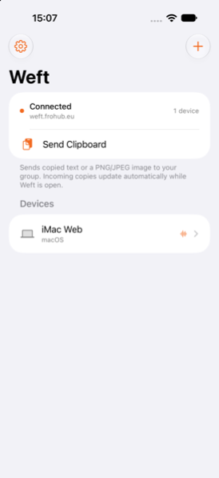
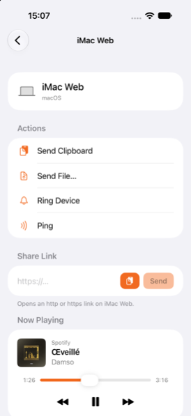
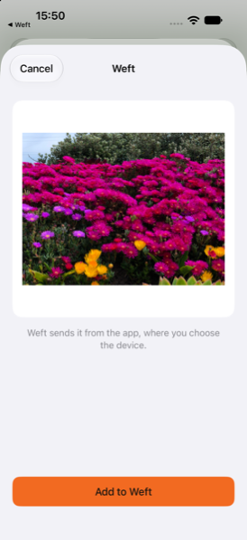
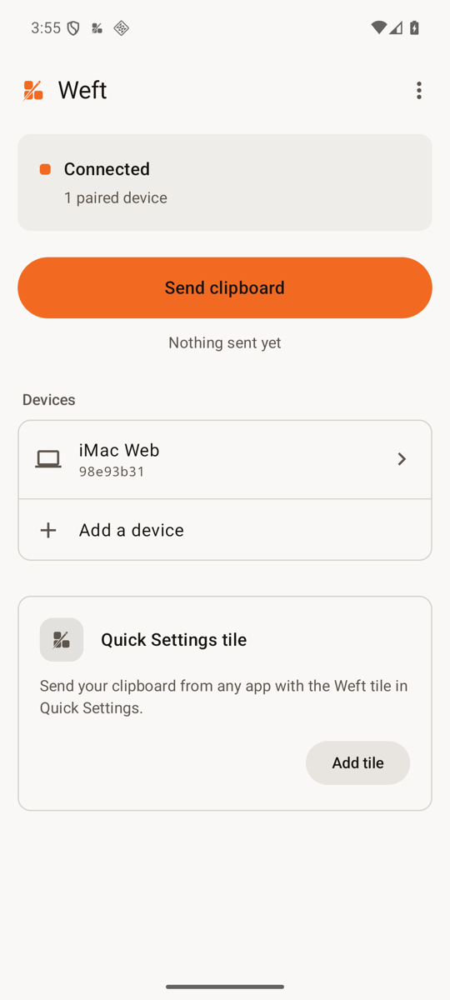
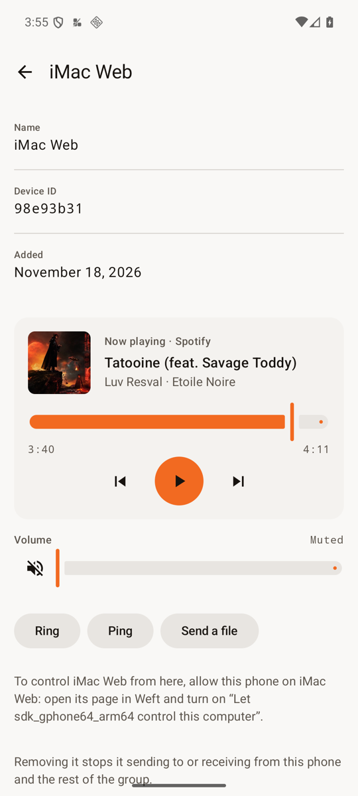
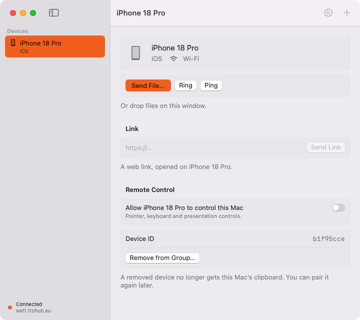

<p align="center">
  
</p>

# Weft

**English** · [Français](README.fr.md)

**Your clipboard, files and notifications, woven across your devices — even on networks that keep them apart.**

Weft is an open-source, KDE Connect–style bridge between **Android**, **iOS**, **macOS**, **Windows** and **Linux**, with a command-line client and a self-hostable relay. Devices always reach each other through an end-to-end encrypted WebSocket relay on the internet, so they stay connected on office, school or hotel Wi-Fi where client isolation blocks direct traffic. When they do share a local network, they also open an authenticated direct LAN route and fall back to the relay if it fails.

Protocol specifications: [`docs/protocol.md`](docs/protocol.md) and [`docs/features.md`](docs/features.md). Initial design notes (in French): [`docs/PLAN.md`](docs/PLAN.md).

## Screenshots

| iPhone | | |
| :---: | :---: | :---: |
|  |  |  |
| Home | A paired Mac, with its media | Share extension |

| Android | | macOS |
| :---: | :---: | :---: |
|  |  |  |
| Home | A paired Mac, with its media | Main window |

## Features

| Area | Details |
| --- | --- |
| Clipboard sync | Automatic from macOS, Windows and Linux; one tap from Android (Quick Settings tile, notification action, share sheet or app button) and iOS (Send Clipboard). Sensitive and password-manager clips (`EXTRA_IS_SENSITIVE`, `ConcealedType` / `TransientType` / `AutoGeneratedType`, `x-kde-passwordManagerHint`, Windows cloud/history exclusion formats) are ignored. |
| Clipboard images | PNG and JPEG images up to 16 MiB, offered and accepted per transfer, checked with a BLAKE2b digest and acknowledged chunk by chunk. Automatic from macOS, Windows and Linux; explicit on Android (Copy image to devices) and iOS. Echo protection stops a received image from being sent back. |
| Files and links | End-to-end encrypted 128 KiB file chunks with flow control, automatic resume within 24 hours, sanitised file names moved to Downloads only on completion, and HTTP/HTTPS link sharing. |
| Notifications and calls | Android notifications mirrored to macOS and Windows with actions, inline reply and remote dismiss (Android 15+ one-time codes remain hidden). Incoming and missed call alerts with remote ringer mute. |
| Media and volume | Bidirectional playback state, transport controls, seek and cover art (`media.art`), an Android `MediaStyle` player notification for paired computers, and bidirectional system/media volume control. |
| Status, ring and ping | Phone battery level and network type/signal, bidirectional loud ring ("Find my device") with remote stop, and ping notifications. |
| SMS and contacts | Opt-in (off by default): browse conversations, send SMS and resolve phone contacts from paired computers. Kept in memory only on computers, never written to disk. |
| Remote input and shortcuts | Touchpad, keyboard and gyroscope presentation pointer from phone to computer (explicitly authorised per device on the computer, off by default), typing from a computer into the phone via the opt-in Weft input method, and user-defined computer shortcuts triggered from the phone. |
| Multi-device groups | Up to 10 devices per group across Android, iOS, macOS, Windows, Linux and CLI. QR code pairing (`WEFT1:`), group invitations (`0xB4`/`0xB5`) to add a new computer to an existing group, and offline relay queuing of encrypted group and device-name envelopes (`0x03`–`0x06`). |

On Android, background apps cannot read the clipboard since Android 10. Like KDE Connect, Weft reads it from a short-lived focused activity opened by a Quick Settings tile, notification action, share target or button in the app — without root or ADB workarounds.

On iOS, the app syncs while it is open. iOS suspends background sockets and asks before an app reads the clipboard: tap **Send Clipboard**, or set Settings › Apps › Weft › Paste from Other Apps to **Allow** to skip the prompt. The share extension queues photos, files, links and text for Weft to send.

## How it works

```
Android (Kotlin) ─┐                                ┌─ macOS (Swift + Rust core)
iOS (Swift) ──────┼── WSS 443 ── relay ── WSS 443 ─┼─ Windows (Rust)
                  │       (weft.frohub.eu)         ├─ Linux (Rust)
                  │                                └─ CLI (Rust)
                  └──── authenticated LAN route, when both share a network ────┘
```

- **Native apps and shared core:**
  - Android: Kotlin + Jetpack Compose, Material 3, with `lazysodium-android` for protocol cryptography.
  - macOS: Swift + SwiftUI menu bar and settings app, powered by the shared Rust client core over UniFFI, [Sparkle](https://sparkle-project.org) for updates and [mediaremote-adapter](https://github.com/ungive/mediaremote-adapter) (BSD-3-Clause) for now-playing state.
  - iOS: Swift + SwiftUI app (iOS 17+) with a share extension, built on the Swift `WeftMobileKit` package.
  - Windows: Rust + Win32 tray/clipboard worker + WinUI 3 interface via [windows-reactor](https://github.com/microsoft/windows-rs/tree/master/crates/libs/reactor), sharing `crates/weft-client` with macOS.
  - Linux (**experimental**): `weft-desktop`, a user-service daemon and CLI for Wayland and X11 that drives the desktop's own tools (clipboard, notifications, MPRIS2, PipeWire/PulseAudio, input). It has no graphical interface yet, and its tests replace those tools with fakes: it has not been validated on a real Linux desktop. See [`linux/README.md`](linux/README.md).
  - CLI: `weft` Rust binary for pairing, clipboard streaming and scripting from a terminal.
- **Relay:** written in Rust (`axum` + SQLite), published as a multi-arch Docker image at `ghcr.io/fraustiz/weft/relay`. A public instance runs at `weft.frohub.eu`, and anyone can self-host their own (see [`relay/README.md`](relay/README.md)); the relay URL is configurable in the apps.
- **No accounts:** each install generates its own Ed25519 and X25519 key pairs, and devices pair directly with a QR code.
- **LAN routes:** paired devices announce their private IPv4 endpoints through the relay, authenticate each other with a signed challenge (`weft-lan-v2`), and exchange the same sealed envelopes directly. Each frame is confirmed by a receipt; an unconfirmed frame goes out again through the relay with the same bytes, and replay protection drops any duplicate.

## Repository layout

- [`android/`](android/) — Android app (`:app`) and Kotlin wire protocol implementation (`:protocol`).
- [`macos/`](macos/) — macOS SwiftUI app, packaging scripts and Sparkle configuration.
- [`ios/`](ios/) — iOS SwiftUI app, share extension and `WeftMobileKit` package (XcodeGen project).
- [`windows/`](windows/) — Windows Rust app (Win32 tray/clipboard host and WinUI 3 views).
- [`linux/`](linux/) — `weft-desktop` Linux daemon and CLI (experimental).
- [`relay/`](relay/) — WebSocket relay server, Dockerfile and Compose configuration.
- [`cli/`](cli/) — `weft` command-line client.
- [`crates/`](crates/) — Rust workspace crates: `weft-protocol` (v1 wire protocol and reference test vectors), `weft-client` (shared client state machine, transfers and feature packets) and `weft-ffi` (UniFFI bindings for macOS).
- [`swift/`](swift/) — `WeftProtocol` standalone Swift package verified byte-for-byte against `crates/weft-protocol/vectors/v1.json`.

## Security model

- **End-to-end encryption** with libsodium (`XChaCha20-Poly1305` IETF AEAD with the 58-byte clear routing header bound as associated data, and `crypto_kx` pairwise session keys). Every client implementation (Rust, Kotlin, Swift) is tested byte-for-byte against [`crates/weft-protocol/vectors/v1.json`](crates/weft-protocol/vectors/v1.json).
- **Untrusted relay:** the relay never sees clipboard text, packets, files, device names or group membership keys. It routes envelopes on their header without inspecting payload contents, and queues only encrypted group-change and device-name envelopes (`0x03`–`0x06`) while a group member is offline. Each device maintains its own local list of trusted peer keys, so the relay cannot inject or swap a device.
- **Authenticated pairing and invitations:** the QR code (`WEFT1:`) carries a 32-byte one-time secret that never crosses the relay. Join requests (`0xB1`) and group invitations (`0xB5`) authenticate the peer's public keys with keyed BLAKE2b MACs under distinct domain contexts (`weft-pair-v1` vs `weft-invite-v1`), verified in constant time; devices already in a group ignore incoming invitations so scanning their code cannot move them out of their group.
- **Replay protection:** per-peer monotonic counters and a persistent 1024-message sliding window of `message_id` values.
- **Known limit:** no forward secrecy in v1.

## Distribution

Builds are published on GitHub Releases (no app stores for now):
- the macOS app is ad-hoc signed and not notarized: open it the first time with right-click → Open;
- the Windows executable is unsigned, so SmartScreen warns on first launch;
- the Android APK is signed with the project's release key.

The iOS app is published as `Weft-X.Y.Z-ios.ipa` for testers, without the App Store or TestFlight: install it with [SideStore](https://sidestore.io) or [AltStore](https://altstore.io) using your own free Apple ID. A free Apple ID signs apps for 7 days, after which SideStore or AltStore has to refresh it, and the iOS app does not update itself. The Linux client is not part of the releases yet: build it from source ([`linux/README.md`](linux/README.md)).

### Releases and updates

All three apps check GitHub Releases (`releases/latest/download/…`) and update themselves:
- **macOS:** `Weft-X.Y.Z-mac.zip` + `appcast.xml`, verified with an EdDSA signature by [Sparkle](https://sparkle-project.org) against [`macos/sparkle-public-key.txt`](macos/sparkle-public-key.txt).
- **Android:** `weft-X.Y.Z.apk` + `android-update.json`, verified by SHA-256 before handing the APK to Android's `PackageInstaller` (which enforces signing-certificate continuity).
- **Windows:** `weft-X.Y.Z-windows.exe` + `windows-update.json`, verified by SHA-256 and PE header validation before performing an in-place self-update.

To cut a release, push a tag `app-vX.Y.Z`:

```sh
git tag app-v1.2.0 && git push origin app-v1.2.0
```

[`.github/workflows/app-release.yml`](.github/workflows/app-release.yml) builds the apps at version `X.Y.Z` (build number and `versionCode`: the commit count) and publishes the GitHub Release with `Weft-X.Y.Z-mac.zip`, `appcast.xml`, `weft-X.Y.Z.apk`, `android-update.json`, `weft-X.Y.Z-windows.exe`, `windows-update.json` and `Weft-X.Y.Z-ios.ipa`. Run it manually (Actions › App release › Run workflow) for a dry run that builds and signs without publishing.

Repository secrets required by the release workflow: `SPARKLE_ED_PRIVATE_KEY`, `ANDROID_KEYSTORE_BASE64`, `ANDROID_KEYSTORE_PASSWORD`, `ANDROID_KEY_ALIAS`, `ANDROID_KEY_PASSWORD`.

Keep the Sparkle EdDSA private key and the Android release keystore in a keychain or password manager and in the repository secrets — never in the repository. Losing the Sparkle private key or the Android signing key prevents installed copies from accepting future updates; leaking the Sparkle private key lets anyone sign a macOS update. `macos/scripts/update-e2e.sh` exercises the Sparkle update flow locally with a temporary key.

## Brand

The logo is hand-drawn SVG in two colours: sunset orange `#F26A21` on ink `#17130F` or cream `#F6EFE6`. No AI-generated images. See [`brand/`](brand/).

## License

[MIT](LICENSE) — the whole project: apps, relay, protocol, logo and docs.
